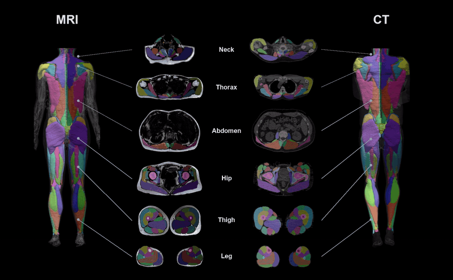
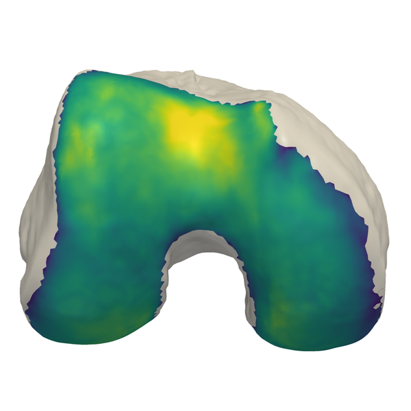
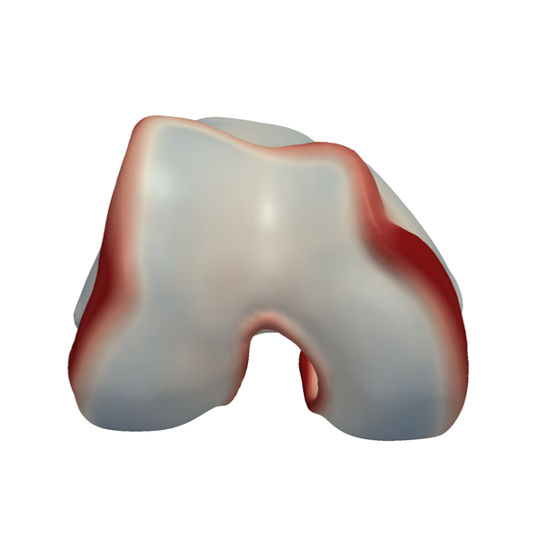

# Stanford Musculoskeletal Imaging Workshop

<p align="center">
   <b>November 9–11, 2026</b><br>
   Hands-on image analysis sessions. Installation instructions and example data for each session are in this repository.
</p>

| Session | Lead | Go to |
|:--|:--|:--|
| 🦵 **MuscleMap Toolbox Hands-On Image Analysis** | Dr. Eddo Wesselink | [Three ways to run MuscleMap](#three-ways-to-run-musclemap) · [Example data](#example-data) |
| 🦴 **OpenMSK Hands-On Image Analysis** | Dr. Anthony Gatti | [Three ways to run OpenMSK](#three-ways-to-run-openmsk) · [Before the session](#before-the-session) · [Example data](#openmsk-example-data) |

> Please complete the installation at home before the workshop. The downloads are several gigabytes.

<br>

## MuscleMap Toolbox Hands-On Image Analysis

*Led by Dr. Eddo Wesselink*

<p align="center">
   
</p>

<p align="center">
   <b>🦵 All MuscleMap labels can be found on the <a href="https://musclemap.github.io/MuscleMap/muscle-anatomy/">MuscleMap website</a></b>
</p>

<p align="center">
   <b>🧊 Explore MuscleMap segmentations in 3D in our <a href="https://musclemap-3d.eddo-wesselink.workers.dev/">MuscleMap 3D viewer</a></b>
</p>

[MuscleMap](https://github.com/MuscleMap/MuscleMap) is a free, open-source toolbox for whole-body muscle segmentation and analysis of MRI and CT images.

### Three ways to run MuscleMap

Choose one of the three options below and click it to expand the instructions.

| | Option | Best for | Installation |
|:-:|:--|:--|:--|
| 1 | [**Terminal** (Python command line)](#option-1-terminal) | Batch processing, scripting, extracting metrics | ~15 min |
| 2 | [**3D Slicer** (desktop app, point-and-click)](#option-2-slicer) | Running and visually inspecting single cases | ~15 min |
| 3 | [**NeuroDesk web app** (browser)](#option-3-neurodesk) | Trying MuscleMap without installing anything | None |

<a name="option-1-terminal"></a>
<details>
<summary><b>Option 1 — Terminal (Python command line)</b></summary>

<br>

All commands below can be copied and pasted into a terminal:

* **Windows:** Anaconda Prompt (installed with Miniconda in Step 1)
* **macOS:** Terminal
* **Linux:** your terminal of choice

You will download two things along the way, and both folders stay on your computer:

| | What it is | Step |
|:--|:--|:--|
| **MuscleMap** | The software that does the segmentation | Step 3 |
| **This workshop repository** | The example images and the hands-on notebook | Step 7 |

1. **Install Miniconda**

   Skip this step if Anaconda or Miniconda is already installed.

   Download the installer for your system, run it and accept the default settings:

   | Operating system | Download |
   |---|---|
   | **Windows** | [Miniconda3-latest-Windows-x86_64.exe](https://repo.anaconda.com/miniconda/Miniconda3-latest-Windows-x86_64.exe) |
   | **Mac with Apple Silicon** (M1, M2, M3, M4) | [Miniconda3-latest-MacOSX-arm64.pkg](https://repo.anaconda.com/miniconda/Miniconda3-latest-MacOSX-arm64.pkg) |
   | **Mac with Intel chip** | [Miniconda3-latest-MacOSX-x86_64.pkg](https://repo.anaconda.com/miniconda/Miniconda3-latest-MacOSX-x86_64.pkg) |
   | **Linux** | [Miniconda3-latest-Linux-x86_64.sh](https://repo.anaconda.com/miniconda/Miniconda3-latest-Linux-x86_64.sh) |

   On Linux, run the installer from a terminal and answer `yes` to the prompts:

   ```
   bash ~/Downloads/Miniconda3-latest-Linux-x86_64.sh
   ```

2. **Create and activate the MuscleMap environment**

   ```
   conda create --name MuscleMap python=3.11.8 -y
   conda activate MuscleMap
   ```

   The prompt now starts with `(MuscleMap)`. Run `conda activate MuscleMap` in every new terminal before using MuscleMap.

3. **Download MuscleMap**

   With git:

   ```
   git clone --depth 1 https://github.com/MuscleMap/MuscleMap
   cd MuscleMap
   ```

   Without git: open https://github.com/MuscleMap/MuscleMap, click the green **<> Code ▼** button, choose **Download ZIP** and unzip it. This creates a folder named `MuscleMap-main`. Go into that folder in your terminal:

   ```
   cd Downloads/MuscleMap-main
   ```

4. **Install MuscleMap**

   From inside the MuscleMap folder, with the environment active:

   ```
   pip install -e .
   ```

   This installs MuscleMap and its dependencies, including a CPU build of PyTorch. It takes a few minutes.

   Then install JupyterLab in the same environment and register the environment as a notebook kernel, for the hands-on notebook:

   ```
   python -m pip install jupyterlab ipykernel plotly
   python -m ipykernel install --user --name musclemap --display-name "Python (MuscleMap)"
   ```

5. **Enable your GPU (optional)**

   MuscleMap runs on the CPU by default. An NVIDIA GPU makes segmentation considerably faster. **Without a GPU, continue with Step 6.**

   | Your computer | What to do |
   |---|---|
   | **Mac** (Intel or Apple Silicon) | Nothing. MuscleMap uses NVIDIA GPUs only; on a Mac it runs on the CPU. Continue with Step 6. |
   | **Windows / Linux with an NVIDIA GPU** | Follow **5a**. |
   | **Linux with an AMD GPU** (ROCm) | Follow **5b**. |

   - **5a — NVIDIA GPU (Windows or Linux)**

     1. Run:

        ```
        nvidia-smi
        ```

     2. Read the `CUDA Version` in the top-right corner of the output.

     3. Run the command for your CUDA version:

        **CUDA 12.1 or higher**

        ```
        pip uninstall -y torch
        pip install torch==2.4.1 --index-url https://download.pytorch.org/whl/cu121
        ```

        **CUDA 11.8, 11.9 or 12.0**

        ```
        pip uninstall -y torch
        pip install torch==2.4.1 --index-url https://download.pytorch.org/whl/cu118
        ```

        **CUDA lower than 11.8:** update your NVIDIA driver from https://www.nvidia.com/drivers, restart, and use the command for CUDA 12.1 or higher.

     4. Verify:

        ```
        python -c "import torch; print('PyTorch', torch.__version__); print('GPU available:', torch.cuda.is_available())"
        ```

        Expected output: `GPU available: True`.

   - **5b — AMD GPU with ROCm (Linux only)**

     ```
     pip uninstall -y torch
     pip install torch==2.4.1 --index-url https://download.pytorch.org/whl/rocm6.1
     python -c "import torch; print('GPU available:', torch.cuda.is_available())"
     ```

6. **Verify the installation**

   ```
   mm_segment -h
   ```

   A help message listing the options of `mm_segment` confirms that the installation works.

7. **Download this workshop repository**

   It contains the example images and the hands-on notebook. Put it next to the MuscleMap folder. With git:

   ```
   cd ..
   git clone --depth 1 https://github.com/NeuromuscularInsightLab/Stanford_Musculoskeletal_Imaging_Workshop
   cd Stanford_Musculoskeletal_Imaging_Workshop
   ```

   Without git: open https://github.com/NeuromuscularInsightLab/Stanford_Musculoskeletal_Imaging_Workshop, click the green **<> Code ▼** button, choose **Download ZIP** and unzip it next to the MuscleMap folder. This creates a folder named `Stanford_Musculoskeletal_Imaging_Workshop-main`; go into that folder in your terminal.

   All commands from here on are run from inside the workshop folder.

8. **Download the model weights**

   The segmentation model is downloaded from Zenodo the first time `mm_segment` runs. Do this once at home on the example image:

   ```
   mm_segment -i data/MuscleMap/source-data/lumbar/sub-01_T2w_L4-L5.nii.gz -o data/MuscleMap/outputs/lumbar
   ```

   The segmentation `sub-01_T2w_L4-L5_dseg.nii.gz` is written to `data/MuscleMap/outputs/lumbar/`. The model is now cached on your computer.

9. **Extract metrics: muscle and fat per structure**

   `mm_extract_metrics` takes the image (`-i`) and the segmentation (`-s`) from Step 8 and separates each labelled structure into muscle and fat. With `-m gmm` a Gaussian mixture model with two components (`-c 2`: muscle and fat) is fitted to the intensities, the same method the notebook uses. From the repository folder run:

   ```
   mm_extract_metrics -m gmm -r wholebody -i data/MuscleMap/source-data/lumbar/sub-01_T2w_L4-L5.nii.gz -s data/MuscleMap/outputs/lumbar/sub-01_T2w_L4-L5_dseg.nii.gz -c 2 -o data/MuscleMap/outputs/lumbar
   ```

   This writes to `data/MuscleMap/outputs/lumbar/`:

   | File | Contents |
   |:--|:--|
   | `sub-01_T2w_L4-L5_gmm_2component_results.csv` | Per structure: muscle %, fat %, total volume (ml) and fat volume (ml) |
   | `sub-01_T2w_L4-L5_gmm_2component_fat_seg.nii.gz` | Voxels classified as fat |
   | `sub-01_T2w_L4-L5_gmm_2component_muscle_seg.nii.gz` | Voxels classified as muscle |
   | `sub-01_T2w_L4-L5_gmm_fat_2component_softseg.nii.gz` | Posterior probability of fat per voxel (0–1) |

   Open the CSV in Excel or any text editor. For Dixon scans use `-m dixon` with the fat (`-f`) and water (`-w`) images instead of `-i`; run `mm_extract_metrics -h` for all options.

Having trouble with the installation? Email eowess@stanford.edu.

#### Useful links

* MuscleMap repository: https://github.com/MuscleMap/MuscleMap
* Installation and usage video tutorial: https://www.youtube.com/watch?v=utlUVdvy6WI
* Label definitions: https://musclemap.github.io/MuscleMap/muscle-anatomy/

</details>

<a name="option-2-slicer"></a>
<details>
<summary><b>Option 2 — 3D Slicer (desktop app, point-and-click)</b></summary>

<br>

[3D Slicer](https://www.slicer.org/) is a free, open-source desktop application for medical image visualisation. MuscleMap is available as a Slicer extension, so images can be segmented and inspected without typing any commands.

**Video tutorial:** https://www.youtube.com/watch?v=aAXxopcMeKI&t=14s. The video installs the *Preview Release* of Slicer; MuscleMap is now included in the **Stable Release**, which is what the steps below use.

1. **Install 3D Slicer**

   1. Go to https://download.slicer.org/
   2. Under **Stable Release**, download the version for your operating system (5.12 or newer).
   3. Run the installer and accept the default settings. On macOS, drag Slicer into the Applications folder.
   4. Start 3D Slicer.

2. **Install the MuscleMap extension**

   1. Open **View → Extensions Manager**.
   2. Search for **MuscleMap** and click **Install**. The required **PyTorch** extension is installed with it.
   3. Restart Slicer when asked.

3. **Install PyTorch inside Slicer**

   1. Open **View → Modules → Utilities → PyTorch Utils**.
   2. Click **Install PyTorch**. With the default settings the module detects a compatible NVIDIA GPU and installs the matching build, or a CPU build otherwise.
   3. Wait for the message that PyTorch was installed successfully. This takes several minutes.

4. **Install the MuscleMap dependencies**

   1. Open **View → Modules → MuscleMap → MuscleMap Whole-body Segmentation**.
   2. Click **Install MuscleMap dependencies**. This is a one-time step of several minutes.
   3. Wait for the message *MuscleMap dependencies are installed and ready*.

5. **Run the example image and download the model weights**

   1. Download this repository (green **<> Code ▼** button → **Download ZIP**).
   2. In the MuscleMap module, click **Load volume from file…** and open `data/MuscleMap/source-data/lumbar/sub-01_T2w_L4-L5.nii.gz`.
   3. With the image selected under **Input volume**, click **Run MuscleMap segmentation**. The first run downloads the segmentation model from Zenodo.
   4. The segmentation appears over the image. **Show 3D** renders it in 3D.

#### Troubleshooting

| Problem | Fix |
|---|---|
| MuscleMap does not appear in the Extensions Manager | Install the **Stable Release**, version 5.12 or newer. |
| PyTorch installation fails (Windows) | Close Slicer, right-click the Slicer icon, choose **Run as administrator** and repeat Step 3. |
| Segmentation is slow | Without a GPU, segmentation takes 1 to 20 minutes depending on image size. Under **Advanced**, tick **Force lower overlap**. |
| Segmentation fails with an out-of-memory error | Under **Advanced**, tick **Force CPU (ignore GPU)** and run again. |

</details>

<a name="option-3-neurodesk"></a>
<details>
<summary><b>Option 3 — NeuroDesk web app (no installation)</b></summary>

<br>

MuscleMap runs in the browser inside the [NeuroDesk](https://www.neurodesk.org/) environment. Nothing is installed on your computer.

1. Go to https://webapps.neurodesk.org/musclemap/
2. Drag and drop an image into the page. NIfTI files (`.nii`, `.nii.gz`) and DICOM folders are accepted. For the workshop, use `data/MuscleMap/source-data/lumbar/sub-01_T2w_L4-L5.nii.gz` from this repository.
3. Select the image and click **Run segmentation**.
4. The labelled result appears in the viewer and can be exported for further analysis.

Processing runs on the CPU and takes a few minutes per image.

</details>

### Example data

The [`data/MuscleMap/`](data/MuscleMap/) folder contains the two example images for the hands-on session: an axial T2-weighted lumbar spine MRI of one patient at the L4–L5 disc level, a stack of four slices as acquired in routine clinical practice, and a Dixon fat-fraction image of both thighs acquired during the hands-on imaging session of this workshop.

| Folder | Contents |
|:--|:--|
| `data/MuscleMap/source-data/lumbar/` | Example 1 input: the lumbar spine image, `sub-01_T2w_L4-L5.nii.gz` |
| `data/MuscleMap/source-data/thigh/` | Example 2 input: the thigh Dixon fat-fraction image, `sub-workshop_thigh-example.nii.gz` |
| `data/MuscleMap/outputs/lumbar/` | Everything MuscleMap produces for Example 1 (lumbar spine), written by the notebook |
| `data/MuscleMap/outputs/thigh/` | Everything MuscleMap produces for Example 2 (thigh Dixon): the segmentation and the metrics are included, ready to use |

Both images are included in this repository; no separate download is needed. The lumbar image comes from the open *Lumbar Spine MRI Dataset* (Sudirman et al., Mendeley Data, CC BY 4.0) and was converted from DICOM to NIfTI. Example 2 of the notebook uses the Dixon fat-fraction image of both thighs from the workshop's hands-on imaging session: 26 axial slices of 8 mm, every tenth slice of the 0.8 mm isotropic acquisition. See [`data/MuscleMap/README.md`](data/MuscleMap/README.md) for the full attributions.

### Hands-on notebook

[`notebooks/MuscleMap_segmentation.ipynb`](notebooks/MuscleMap_segmentation.ipynb) runs MuscleMap on the example image from inside a Jupyter notebook: load and view the image, run `mm_segment`, read the log, and view the segmentation as an overlay, compute volume, cross-sectional area and fat infiltration of the paraspinal muscles, and, as a second example, segment both thighs on a Dixon fat-fraction image and read volume and fat fraction per muscle. It requires *Option 1 — Terminal*.

JupyterLab was installed in Step 4 of *Option 1 — Terminal*. Start it from inside the workshop folder:

```
conda activate MuscleMap
cd <path to the workshop folder>
jupyter lab
```

A browser tab opens with the file browser. Open `notebooks/MuscleMap_segmentation.ipynb`, check that the kernel in the top-right corner is **Python (MuscleMap)**, and run the cells with Shift + Enter.

<br>

---

## OpenMSK Hands-On Image Analysis

*Led by Dr. Anthony Gatti*

<p align="center">
   
   
</p>

[OpenMSK](https://github.com/gattia/OpenMSK) is a free, open-source pipeline for knee MRI. From one scan it returns segmentations of bone, cartilage and menisci, surface meshes, regional cartilage thickness, T2 maps, a neural shape model fit and a B-score for bone shape. You can run it on [openmsk.com](https://openmsk.com) without installing anything.

### Three ways to run OpenMSK

| | Option | Best for | Installation |
|:-:|:--|:--|:--|
| 1 | [**Google Colab notebook**](https://colab.research.google.com/github/NeuromuscularInsightLab/Stanford_Musculoskeletal_Imaging_Workshop/blob/main/notebooks/OpenMSK_hands_on.ipynb) | The session. Everything in the browser, with a free GPU | None |
| 2 | [**Jupyter on your own computer**](#openmsk-local) | Keeping a working copy after the workshop | ~10 min |
| 3 | [**openmsk.com**](https://openmsk.com) | Your own scans, no code | None |

**A GPU is recommended but not required.** It speeds up the shape model in Part 5: in Colab, choose **Runtime → Change runtime type → T4 GPU** (free). Without one, the notebook still runs, on the CPU or on a Mac's Apple GPU. Only the full OpenMSK pipeline (segmentation through B-score) needs an NVIDIA GPU, if you want to run it on your own machine so no data leaves it. Its installation is in the [OpenMSK repository](https://github.com/gattia/OpenMSK).

<a name="before-the-session"></a>
### Before the session (2 minutes)

1. **Open the notebook in Colab:** [](https://colab.research.google.com/github/NeuromuscularInsightLab/Stanford_Musculoskeletal_Imaging_Workshop/blob/main/notebooks/OpenMSK_hands_on.ipynb). You need a Google account.
2. **Check it runs:** choose **Runtime → Change runtime type → T4 GPU**, then run the Setup cell and Part 2.

The shape model in Part 5 downloads by itself from [Hugging Face](https://huggingface.co/aagatti/ShapeMedKnee).

**Please don't upload scans to openmsk.com during the session.** One GPU serves the site, and each scan takes about 9 minutes, so a room of uploads would queue for hours. The notebook uses the example knee, which is already in this repository. You can download it from the site too: *New here? Try the example first* → **MRI + all results**.

<a name="openmsk-local"></a>
<details>
<summary><b>Option 2: Jupyter on your own computer</b></summary>

<br>

You need [Miniconda](#option-1-terminal) (Step 1 of the MuscleMap install) and [git](https://git-scm.com/downloads). No git? Download this repository as a ZIP from the green **<> Code** button, unzip it, and `cd` into it instead of the first two lines. Use a separate environment from MuscleMap's:

```
git clone https://github.com/NeuromuscularInsightLab/Stanford_Musculoskeletal_Imaging_Workshop.git
cd Stanford_Musculoskeletal_Imaging_Workshop
conda create --name openmsk-workshop python=3.11 -y
conda activate openmsk-workshop
pip install -r notebooks/OpenMSK_requirements.txt
python -m ipykernel install --user --name openmsk-workshop --display-name "Python (OpenMSK)"
jupyter lab
```

Open `notebooks/OpenMSK_hands_on.ipynb` and check that the kernel in the top-right corner is **Python (OpenMSK)**. Already have this repository from the MuscleMap session? Skip the first two lines and `cd` into it.

Stuck? [`notebooks/OpenMSK_LLM_prompts.md`](notebooks/OpenMSK_LLM_prompts.md#set-up-this-notebook-on-your-own-computer) has prompts that walk an AI assistant through the setup with you.

</details>

<a name="openmsk-example-data"></a>
### Example data

| Folder | Contents |
|:--|:--|
| [`data/OpenMSK/example/`](data/OpenMSK/example/) | One knee MRI and every output OpenMSK produced for it, the same as **MRI + all results** on openmsk.com |
| [`data/OpenMSK/oai_teaching_cohort/`](data/OpenMSK/oai_teaching_cohort/) | 500 OAI knees, 100 per KL grade: B-score, cartilage thickness, pain, knee replacement, and each knee's shape-model latent |
| [`data/OpenMSK/decoded/`](data/OpenMSK/decoded/) | Shape-model knees decoded ahead of time, used only if the model can't be downloaded |

See [`data/OpenMSK/README.md`](data/OpenMSK/README.md) for details and attribution.

### Hands-on notebook

[`notebooks/OpenMSK_hands_on.ipynb`](notebooks/OpenMSK_hands_on.ipynb) goes from the website to your own analysis:

1. **The website:** what to upload and which options to pick
2. **One knee:** every output for the example knee, including labels, meshes, thickness, the shape model fit and the B-score
3. **A cohort:** 500 OAI knees, and five minutes to explore them yourself
4. **B-score analyses:** the two B-scores, thickness by KL grade, pain and knee replacement
5. **The shape model:** turn latent vectors back into knees, see group differences and build your own axis
6. **Your turn:** pick a question, run it, and tell the room. Then many scans into one sheet, and where to go next

[`notebooks/OpenMSK_LLM_prompts.md`](notebooks/OpenMSK_LLM_prompts.md) has each step as a prompt for an LLM.

*Research use only. Not for clinical diagnosis.* If OpenMSK contributes to your work, please cite Goyal A et al., *Osteoarthritis and Cartilage Open*, 2026;8(4):100886.
