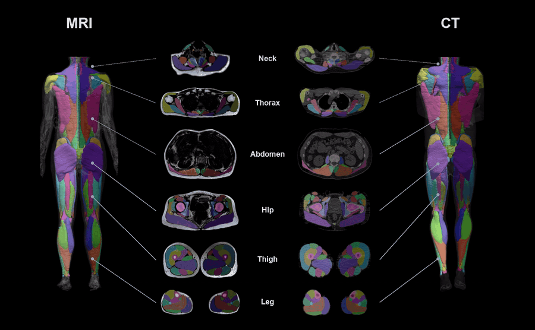

# Stanford Musculoskeletal Imaging Workshop

<p align="center">
   <b>November 9–11, 2026</b><br>
   Hands-on image analysis sessions. Installation instructions and example data for each session are in this repository.
</p>

| Session | Lead | Go to |
|:--|:--|:--|
| 🦵 **MuscleMap Toolbox Hands-On Image Analysis** | Dr. Eddo Wesselink | [Three ways to run MuscleMap](#three-ways-to-run-musclemap) · [Example data](#example-data) |
| 🦴 **OpenMSK Hands-On Image Analysis** | Dr. Anthony Gatti | [Installation](#1-installation) · [Data](#2-data) |

> Please complete the installation at home before the workshop. The downloads are several gigabytes.

<br>

## MuscleMap Toolbox Hands-On Image Analysis

*Led by Dr. Eddo Wesselink*

<p align="center">
   
</p>

<p align="center">
   <b>🦵 All MuscleMap labels can be found on the <a href="https://musclemap.github.io/MuscleMap/muscle-anatomy/">MuscleMap website</a></b>
</p>

<p align="center">
   <b>🧊 Explore MuscleMap segmentations in 3D in our <a href="https://musclemap-3d.eddo-wesselink.workers.dev/">MuscleMap 3D viewer</a></b>
</p>

[MuscleMap](https://github.com/MuscleMap/MuscleMap) is a free, open-source toolbox for whole-body muscle segmentation and analysis of MRI and CT images.

### Three ways to run MuscleMap

Choose one of the three options below and click it to expand the instructions.

| | Option | Best for | Installation |
|:-:|:--|:--|:--|
| 1 | [**Terminal** (Python command line)](#option-1-terminal) | Batch processing, scripting, extracting metrics | ~15 min |
| 2 | [**3D Slicer** (desktop app, point-and-click)](#option-2-slicer) | Running and visually inspecting single cases | ~15 min |
| 3 | [**NeuroDesk web app** (browser)](#option-3-neurodesk) | Trying MuscleMap without installing anything | None |

<a name="option-1-terminal"></a>
<details>
<summary><b>Option 1 — Terminal (Python command line)</b></summary>

<br>

All commands below can be copied and pasted into a terminal:

* **Windows:** Anaconda Prompt (installed with Miniconda in Step 1)
* **macOS:** Terminal
* **Linux:** your terminal of choice

1. **Install Miniconda**

   Skip this step if Anaconda or Miniconda is already installed.

   Download the installer for your system, run it and accept the default settings:

   | Operating system | Download |
   |---|---|
   | **Windows** | [Miniconda3-latest-Windows-x86_64.exe](https://repo.anaconda.com/miniconda/Miniconda3-latest-Windows-x86_64.exe) |
   | **Mac with Apple Silicon** (M1, M2, M3, M4) | [Miniconda3-latest-MacOSX-arm64.pkg](https://repo.anaconda.com/miniconda/Miniconda3-latest-MacOSX-arm64.pkg) |
   | **Mac with Intel chip** | [Miniconda3-latest-MacOSX-x86_64.pkg](https://repo.anaconda.com/miniconda/Miniconda3-latest-MacOSX-x86_64.pkg) |
   | **Linux** | [Miniconda3-latest-Linux-x86_64.sh](https://repo.anaconda.com/miniconda/Miniconda3-latest-Linux-x86_64.sh) |

   On Linux, run the installer from a terminal and answer `yes` to the prompts:

   ```
   bash ~/Downloads/Miniconda3-latest-Linux-x86_64.sh
   ```

2. **Create and activate the MuscleMap environment**

   ```
   conda create --name MuscleMap python=3.11.8 -y
   conda activate MuscleMap
   ```

   The prompt now starts with `(MuscleMap)`. Run `conda activate MuscleMap` in every new terminal before using MuscleMap.

3. **Download MuscleMap**

   With git:

   ```
   git clone --depth 1 https://github.com/MuscleMap/MuscleMap
   cd MuscleMap
   ```

   Without git: open https://github.com/MuscleMap/MuscleMap, click the green **<> Code ▼** button, choose **Download ZIP** and unzip it. This creates a folder named `MuscleMap-main`. Go into that folder in your terminal:

   ```
   cd Downloads/MuscleMap-main
   ```

4. **Install MuscleMap**

   From inside the MuscleMap folder, with the environment active:

   ```
   pip install -e .
   ```

   This installs MuscleMap and its dependencies, including a CPU build of PyTorch. It takes a few minutes.

5. **Enable your GPU (optional)**

   MuscleMap runs on the CPU by default. An NVIDIA GPU makes segmentation considerably faster. **Without a GPU, continue with Step 6.**

   | Your computer | What to do |
   |---|---|
   | **Mac** (Intel or Apple Silicon) | Nothing. MuscleMap uses NVIDIA GPUs only; on a Mac it runs on the CPU. Continue with Step 6. |
   | **Windows / Linux with an NVIDIA GPU** | Follow **5a**. |
   | **Linux with an AMD GPU** (ROCm) | Follow **5b**. |

   - **5a — NVIDIA GPU (Windows or Linux)**

     1. Run:

        ```
        nvidia-smi
        ```

     2. Read the `CUDA Version` in the top-right corner of the output.

     3. Run the command for your CUDA version:

        **CUDA 12.1 or higher**

        ```
        pip uninstall -y torch
        pip install torch==2.4.1 --index-url https://download.pytorch.org/whl/cu121
        ```

        **CUDA 11.8, 11.9 or 12.0**

        ```
        pip uninstall -y torch
        pip install torch==2.4.1 --index-url https://download.pytorch.org/whl/cu118
        ```

        **CUDA lower than 11.8:** update your NVIDIA driver from https://www.nvidia.com/drivers, restart, and use the command for CUDA 12.1 or higher.

     4. Verify:

        ```
        python -c "import torch; print('PyTorch', torch.__version__); print('GPU available:', torch.cuda.is_available())"
        ```

        Expected output: `GPU available: True`.

   - **5b — AMD GPU with ROCm (Linux only)**

     ```
     pip uninstall -y torch
     pip install torch==2.4.1 --index-url https://download.pytorch.org/whl/rocm6.1
     python -c "import torch; print('GPU available:', torch.cuda.is_available())"
     ```

6. **Verify the installation**

   ```
   mm_segment -h
   ```

   A help message listing the options of `mm_segment` confirms that the installation works.

7. **Download the model weights**

   The segmentation model is downloaded from Zenodo the first time `mm_segment` runs. Do this once at home on the example image: download this repository (green **<> Code ▼** button → **Download ZIP**, or `git clone`), go into its `data/MuscleMap` folder in your terminal and run:

   ```
   mm_segment -i sub-01_T2w_L4-L5.nii.gz
   ```

   The segmentation `sub-01_T2w_L4-L5_dseg.nii.gz` is written next to the input image. The model is now cached on your computer.

Having trouble with the installation? Email eowess@stanford.edu.

#### Useful links

* MuscleMap repository: https://github.com/MuscleMap/MuscleMap
* Installation and usage video tutorial: https://www.youtube.com/watch?v=utlUVdvy6WI
* Label definitions: https://musclemap.github.io/MuscleMap/muscle-anatomy/

</details>

<a name="option-2-slicer"></a>
<details>
<summary><b>Option 2 — 3D Slicer (desktop app, point-and-click)</b></summary>

<br>

[3D Slicer](https://www.slicer.org/) is a free, open-source desktop application for medical image visualisation. MuscleMap is available as a Slicer extension, so images can be segmented and inspected without typing any commands.

**Video tutorial:** https://www.youtube.com/watch?v=aAXxopcMeKI&t=14s. The video installs the *Preview Release* of Slicer; MuscleMap is now included in the **Stable Release**, which is what the steps below use.

1. **Install 3D Slicer**

   1. Go to https://download.slicer.org/
   2. Under **Stable Release**, download the version for your operating system (5.12 or newer).
   3. Run the installer and accept the default settings. On macOS, drag Slicer into the Applications folder.
   4. Start 3D Slicer.

2. **Install the MuscleMap extension**

   1. Open **View → Extensions Manager**.
   2. Search for **MuscleMap** and click **Install**. The required **PyTorch** extension is installed with it.
   3. Restart Slicer when asked.

3. **Install PyTorch inside Slicer**

   1. Open **View → Modules → Utilities → PyTorch Utils**.
   2. Click **Install PyTorch**. With the default settings the module detects a compatible NVIDIA GPU and installs the matching build, or a CPU build otherwise.
   3. Wait for the message that PyTorch was installed successfully. This takes several minutes.

4. **Install the MuscleMap dependencies**

   1. Open **View → Modules → MuscleMap → MuscleMap Whole-body Segmentation**.
   2. Click **Install MuscleMap dependencies**. This is a one-time step of several minutes.
   3. Wait for the message *MuscleMap dependencies are installed and ready*.

5. **Run the example image and download the model weights**

   1. Download this repository (green **<> Code ▼** button → **Download ZIP**).
   2. In the MuscleMap module, click **Load volume from file…** and open `data/MuscleMap/sub-01_T2w_L4-L5.nii.gz`.
   3. With the image selected under **Input volume**, click **Run MuscleMap segmentation**. The first run downloads the segmentation model from Zenodo.
   4. The segmentation appears over the image. **Show 3D** renders it in 3D.

#### Troubleshooting

| Problem | Fix |
|---|---|
| MuscleMap does not appear in the Extensions Manager | Install the **Stable Release**, version 5.12 or newer. |
| PyTorch installation fails (Windows) | Close Slicer, right-click the Slicer icon, choose **Run as administrator** and repeat Step 3. |
| Segmentation is slow | Without a GPU, segmentation takes 1 to 20 minutes depending on image size. Under **Advanced**, tick **Force lower overlap**. |
| Segmentation fails with an out-of-memory error | Under **Advanced**, tick **Force CPU (ignore GPU)** and run again. |

</details>

<a name="option-3-neurodesk"></a>
<details>
<summary><b>Option 3 — NeuroDesk web app (no installation)</b></summary>

<br>

MuscleMap runs in the browser inside the [NeuroDesk](https://www.neurodesk.org/) environment. Nothing is installed on your computer.

1. Go to https://webapps.neurodesk.org/musclemap/
2. Drag and drop an image into the page. NIfTI files (`.nii`, `.nii.gz`) and DICOM folders are accepted. For the workshop, use `data/MuscleMap/sub-01_T2w_L4-L5.nii.gz` from this repository.
3. Select the image and click **Run segmentation**.
4. The labelled result appears in the viewer and can be exported for further analysis.

Processing runs on the CPU and takes a few minutes per image.

</details>

### Example data

The [`data/MuscleMap/`](data/MuscleMap/) folder contains the example image for the hands-on session: an axial T2-weighted lumbar spine MRI of one patient at the L4–L5 disc level.

| File | Level | Slices |
|:--|:--|:-:|
| `data/MuscleMap/sub-01_T2w_L4-L5.nii.gz` | L4–L5 | 4 |

The image is a stack of axial slices through the L4–L5 intervertebral disc, as acquired in routine clinical practice. It is included in this repository; no separate download is needed.

The image comes from the open *Lumbar Spine MRI Dataset* (Sudirman et al., Mendeley Data, CC BY 4.0) and was converted from DICOM to NIfTI. See [`data/MuscleMap/README.md`](data/MuscleMap/README.md) for the full attribution.

### Hands-on notebook

[`notebooks/MuscleMap_segmentation.ipynb`](notebooks/MuscleMap_segmentation.ipynb) runs MuscleMap on the example image from inside a Jupyter notebook: load and view the image, run `mm_segment`, read the log, and view the segmentation as an overlay and in 3D. It requires *Option 1 — Terminal*.

Install JupyterLab in the MuscleMap environment and register the environment as a notebook kernel (one-time), then start JupyterLab inside this repository's folder:

```
conda activate MuscleMap
python -m pip install jupyterlab ipykernel
python -m ipykernel install --user --name musclemap --display-name "Python (MuscleMap)"
cd <path to this repository>
jupyter lab
```

A browser tab opens with the file browser. Open `notebooks/MuscleMap_segmentation.ipynb`, check that the kernel in the top-right corner is **Python (MuscleMap)**, and run the cells with Shift + Enter.

<br>

---

## OpenMSK Hands-On Image Analysis

*Led by Dr. Anthony Gatti*

### 1. Installation

### 2. Data
